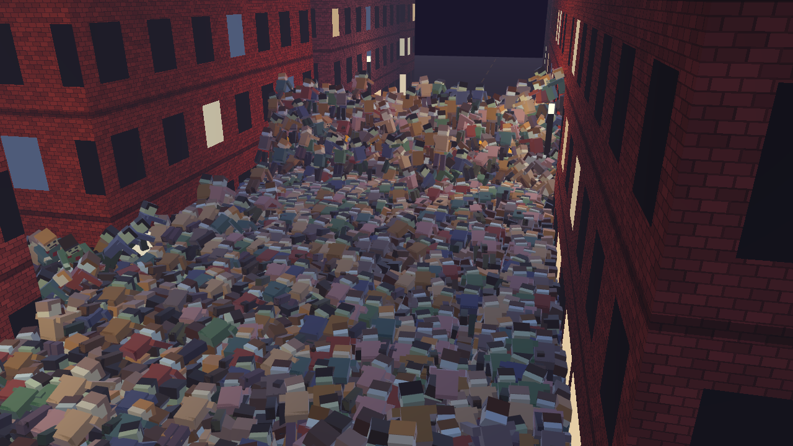

# Tiny Tiny Zombies — engine prototype (phases 1 and 3)

Native C++20 / SDL3 GPU engine for a zombie-apocalypse strategy game.

- **Phase 1** built the engine foundation and a **GPU horde simulation**. Every zombie is an individual agent; together they flow through streets, compress at bottlenecks, climb over each other into piles that collapse, get blown apart by explosions, and leave persistent bodies that later zombies walk over.
- **Phase 3** integrates the **approved Zombie Lab characters**: ten interchangeable voxel segments, per-zombie modular appearance, GPU-driven culling, batching and animation.



## Status

| Area | State |
|---|---|
| Native app, SDL3 GPU, CMake | Done. Builds warning-free with GCC 13 (Linux). |
| RTS camera (perspective, 360° yaw, pitch/zoom limits, smoothing, keeps out of buildings) | Done |
| Instanced voxel zombies, procedural GPU animation, glTF/GLB (Blockbench-compatible) | Done |
| GPU counting-sort grid, density field, Eikonal flow field | Done, covered by tests |
| PBD capsule contacts, compression, obstacle collision | Done, covered by tests |
| Climbing and vertical accumulation, collapse | Done, covered by tests |
| Death, persistent corpses, corpse height field, traversal, reactivation | Done, covered by tests |
| Explosions (impulse, kill/stun, pile collapse, refill) | Done, covered by tests |
| Debug UI (ImGui), overlays, parameter file, benchmarks | Done. UI rendered under Xvfb, input untested. |
| Approved modular characters (10 segments, 37 modules, palettes, decoration), converted from Zombie Lab | Done, covered by tests. See docs/CHARACTER_STANDARD.md and docs/ASSET_PIPELINE.md. |
| Randomised appearances (configurable weights), corpses keep their zombie's look | Done, covered by tests |
| GPU-driven character rendering: frustum culling, size-class batching, per-character pose, vertex pulling, greedy meshes | Done, covered by tests and benchmarked (docs/OPTIMIZATION.md) |
| Gore: blood spray and pools, wall splatter, severed limbs as physical body parts, torn-apart zombies, legless crawlers, scorch marks, voxel fireball / smoke / debris | Done (phase 4), covered by tests |
| Bodies settle instead of spinning against walls; screen shake; moon shadows of buildings | Done (phase 4) |
| **macOS / Metal** | Phase 3 measured by the owner on a MacBook Air: 10,000 zombies at 105–126 FPS at 1080p (docs/BENCHMARKS.md). Phase 4 not yet measured on the Mac. |

## Validation status

Everything here was **built and executed on Linux x86-64 with Mesa lavapipe**, a software Vulkan 1.4 driver running on the CPU. That covers the real SDL3 GPU Vulkan code path end to end: all compute passes, indirect dispatch and draw, rendering, MSAA, and readback. The headless self-test passes, and screenshots in `docs/media` come from that path.

**Not yet verified:**

1. **macOS/Metal.** The MSL shaders are generated by SDL_shadercross and their binding layout was checked by hand, but no Metal driver has compiled them.
2. **Mouse and keyboard interaction.** The windowed path itself (SDL window, swapchain, ImGui, overlays, async stats) **was run under Xvfb**; see `docs/media/debug_ui_xvfb.png`. No real input events were exercised.
3. **Performance on real GPUs.** Lavapipe timings are CPU-emulated and not representative.

The first job on the development Mac is to run `ttz_selftest`, then `ttz --bench`, and fill in `docs/BENCHMARKS.md`.

## Build

Requirements:
- CMake ≥ 3.24 and a C++20 compiler (Xcode 15+ / clang 16+, MSVC 2022, GCC 13).
- Git and network access for the first configure: SDL3, Dear ImGui, cgltf and stb are fetched by CMake.
- **No shader tools are needed.** Compiled SPIR-V / MSL / reflection files are committed.

### macOS (Apple Silicon)

```bash
cmake -S . -B build -G Xcode
```

```bash
cmake --build build --config Release
```

```bash
./build/Release/ttz_selftest
```

```bash
./build/Release/ttz
```

Ninja or Makefiles work too (`cmake -S . -B build -DCMAKE_BUILD_TYPE=Release`); the binaries are then in `build/`.

### Windows

```bash
cmake -S . -B build -G "Visual Studio 17 2022"
```

```bash
cmake --build build --config Release
```

```bash
build\Release\ttz.exe
```

SDL picks the **Vulkan** backend: the same SPIR-V shaders, and a Vulkan-capable driver is required. D3D12 needs DXIL shaders, which need SDL_shadercross built with DXC (see `docs/RESEARCH.md` §4). That is planned, not done.

### Linux

```bash
cmake -S . -B build -DCMAKE_BUILD_TYPE=Release && cmake --build build -j
```

Without a GPU, the Mesa software driver works for testing (slowly):

```bash
VK_ICD_FILENAMES=/usr/share/vulkan/icd.d/lvp_icd.json ./build/ttz_selftest
```

## Run

```bash
./build/ttz                          # interactive sandbox
```

```bash
./build/ttz --scenario 2 --count 5000
```

```bash
./build/ttz --headless --scenario 2 --frames 900 --screenshot siege.png --cam 57 0 -1.35 0.38 26
```

```bash
./build/ttz --bench --bench-counts 1000,5000,10000,25000,50000 --bench-csv results.csv
```

```bash
./build/ttz_selftest --dump /tmp/ttz
```

| Option | Meaning |
|---|---|
| `--scenario N` | 0 avenue march, 1 intersection merge, 2 wall siege, 3 dispersed city, 4 arena horde, 5 arena siege |
| `--count N` | number of zombies (default per scenario) |
| `--headless` | no window (offscreen render); combine with `--frames` and `--screenshot` |
| `--cam x z yaw pitch dist` | camera target and orbit (radians, metres) |
| `--blast frame x z` | scripted explosion (repeatable), for reproducible footage |
| `--debug-flags N` | overlays bitmask: 1 density, 2 flow, 4 grid, 8 nav distance, 16 corpse height |
| `--config path` | parameter file (default `config/sim.cfg`) |
| `--save-config path` | write every parameter with its default value |
| `--no-vsync`, `--gpu-debug` | presentation / validation |
| `--chars modular\|placeholder` | approved characters (default) or the phase-1 placeholder |
| `--geom naive\|culled\|greedy`, `--classes family\|size`, `--no-cull`, `--pose-vs` | character optimisation toggles, for comparisons |
| `--anim auto\|idle\|walk\|reach\|climb\|flail\|dying\|corpse` | force an animation for previews |
| `--showcase 0\|1\|2\|3\|10\|11\|12` | validation scenes: Lab lineup, lineup corpses, random grid, crowd, single Office Drone / Street Walker / Rotter |
| `--studio`, `--no-ground`, `--free-cam`, `--fov deg`, `--cam-y m` | neutral studio lighting and camera control for comparisons |
| `--bench-configs ...`, `--bench-scenarios dispersed,siege,city,offscreen,corpses` | benchmark matrix (see docs/BENCHMARKS.md); phase 4 adds `phase3`, `final-tris`, `final-noshadow` |
| `--trace N` | headless: log zombie / airborne / death / corpse counts every N frames |

### Controls

| Input | Action |
|---|---|
| WASD / arrows | move (Shift = faster) |
| Mouse wheel | zoom |
| Middle drag, or Alt + left drag | rotate 360° / pitch |
| Q / E | rotate |
| Left click | current tool: **1** explosion, **2** set destination, **3** spawn 500 |
| Space / R | pause / reset scenario |
| + / − | simulation speed |
| V / F / G | density / flow / grid overlays |
| F1 / F12 | toggle UI / screenshot |

The **Gore & effects** panel turns gore, screen shake, shadows and particles on or off; sets blood amount, dismemberment chance, how close a blast must be to tear a zombie apart, and tumble damping; shows particle and body-part counts; and has a *Clean up blood and body parts* button.

The debug panel shows statistics (frame time, simulation CPU cost, GPU memory, RSS, zombie, corpse, climbing and elevated counts, max stack height). It also provides scenario and count selection, spawning, toggles for vertical accumulation and corpses, overlays, and every simulation parameter. *Save* writes `config/sim.cfg`.

## Baked city map (phase 6)

The City Lab city (tools/city_lab) is baked offline into `assets/city/seed1` (format: `tools/city_lab/bake/FORMAT.md`;
the package is large and git-ignored) and streamed by the engine (`src/city/`, `shaders/city.*`).

```bash
node --max-old-space-size=6000 tools/city_lab/bake/bake.js --seed=1 --scale=5 --out=assets/city/seed1
```

```bash
cmake --build build --config Release
```

```bash
./build/Release/ttz --map city                 # Xcode build; ./build/ttz with Ninja / Makefiles
```

```bash
./build/Release/ttz --bench --bench-scenarios citymap --frames 900 --no-vsync
```

| Option | Meaning |
|---|---|
| `--map city` | baked city from `assets/city/seed1` (`--city DIR` for another package) |
| `--city-window N` | simulation window, N x N cells of 0.75 m (default 512 = 384 m) |
| `--city-at x z` | centre of the simulation window (default: the spawn point nearest the map centre) |
| `--city-synth DIR` | write a tiny synthetic package (tests, no bake needed) |
| `--bench-scenarios citymap` | headless game loop, camera flying 1.4 km across the city: frame ms, streaming/upload ms, resident / visible tiles, draws, triangles, instances, GPU MB |

City controls: RTS rig as in City Lab (pivot on the ground, pitch 35–70°, distance 30–300 m). WASD / window edge /
right-drag pan, Q / E or middle-drag rotate, wheel zoom, **F2** free debug camera. The *City* panel shows streaming
statistics and LOD / draw-distance settings.

How it works (details in `src/city/*.h`):
- **Streaming**: tiles under the camera's ground footprint (+1 tile ring) are decoded on a background thread, nearest
  first, and uploaded on the main thread within a per-frame byte budget (8 MB); an LRU keeps 96 tiles.
- **Rendering**: one pipeline, one indexed draw per visible tile (AABB frustum culling, front to back), LOD1 beyond
  420 m (back at 380 m); vehicles and street furniture instanced per variant (vehicle box proxy beyond 160 m, props
  culled beyond 260 m); palette materials with glass / water Fresnel sky reflection and night emission modes (lit
  windows, lamps, beacons, light bars, traffic-signal cycle); the nearest 24 street lamps are point lights.
- **Simulation**: the horde runs in a window of the city (the whole map at 0.75 m would be ~8.4 M cells, ~1.2 GB of
  sim fields and a nav sweep over all of it every step). The window's static height grid is the max of the baked
  0.5 m collision samples per cell (buildings, cars, props, curbs; water is a low wall). Zombies spawn at the
  package's street spawn points. Moon shadows and blood / scorch decals cover the window.

## Benchmark workflow for the development Mac

These commands produce the numbers this environment cannot. Run them on the Mac and paste the printed tables into `docs/BENCHMARKS.md`, or send them over.

```bash
./build/ttz_selftest
```

```bash
./build/ttz --bench --bench-configs placeholder,final --bench-scenarios dispersed,siege,city,offscreen,corpses --bench-csv mac_final.csv
```

```bash
./build/ttz --bench --bench-configs placeholder,naive,culled,greedy,classes,final,final-posevs --bench-scenarios dispersed,siege --bench-counts 10000 --bench-csv mac_ladder.csv
```

Defaults: 1920×1080, 4× MSAA, no vsync, 20 measured frames after warm-up. The interactive app shows draw calls, visible/total characters, triangles and GPU memory in the *Characters* panel. For GPU-side detail, run `ttz --scenario 5 --count 10000` under Xcode's Metal frame capture.

## Repository layout

```
src/app        application loop, benchmark runner, self-test
src/gpu        SDL3 GPU device, shader loading (reflection), dispatch helpers
src/sim        crowd simulation orchestration, parameters, sandbox maps
src/render     renderer, camera, math
src/assets     glTF/GLB loading (cgltf), third-party implementation unit
src/debug      ImGui panel, profiling
shaders/       GLSL sources (+ include/), compiled/{spirv,msl,json}
assets/        characters (approved Zombie Lab source + baked runtime asset), models (phase-1 placeholder GLB)
config/        sim.cfg parameter file
tools/         compile_shaders.py, build_shadercross.sh, convert_characters.mjs, capture_lab.mjs, compare_views.py
docs/          RESEARCH, ARCHITECTURE, BENCHMARKS, DEVELOPMENT_LOG, reference images, media
```

## Editing shaders

```bash
tools/build_shadercross.sh          # once: builds SDL_shadercross (SPIRV-Cross only)
```

```bash
SHADERCROSS=.tools/bin/shadercross python3 tools/compile_shaders.py
```

You also need `glslangValidator` (`brew install glslang`, or the Vulkan SDK on Windows). If both tools are on `PATH`, CMake adds a `shaders` target.

## Replacing the zombie model

Export a glTF/GLB from Blockbench with groups named `head`, `body`, `arm_left`, `arm_right`, `leg_left`, `leg_right` (variants such as `left_arm` or `leg_r` also work). Use group origins at the joints, and the model facing +Z. Save it as `assets/models/zombie.glb`. The engine rescales it to the configured standing height. For appearance variants, stack N copies of the texture vertically and set `"extras": {"ttz_variant_rows": N}`.

## Documentation

- [Research and license review](docs/RESEARCH.md)
- [Architecture](docs/ARCHITECTURE.md)
- [Benchmarks](docs/BENCHMARKS.md)
- [Development log](docs/DEVELOPMENT_LOG.md)
- [Character standard](docs/CHARACTER_STANDARD.md)
- [Asset pipeline](docs/ASSET_PIPELINE.md)
- [Optimisation report](docs/OPTIMIZATION.md)
- [Third-party notices](THIRD_PARTY_NOTICES.md)
